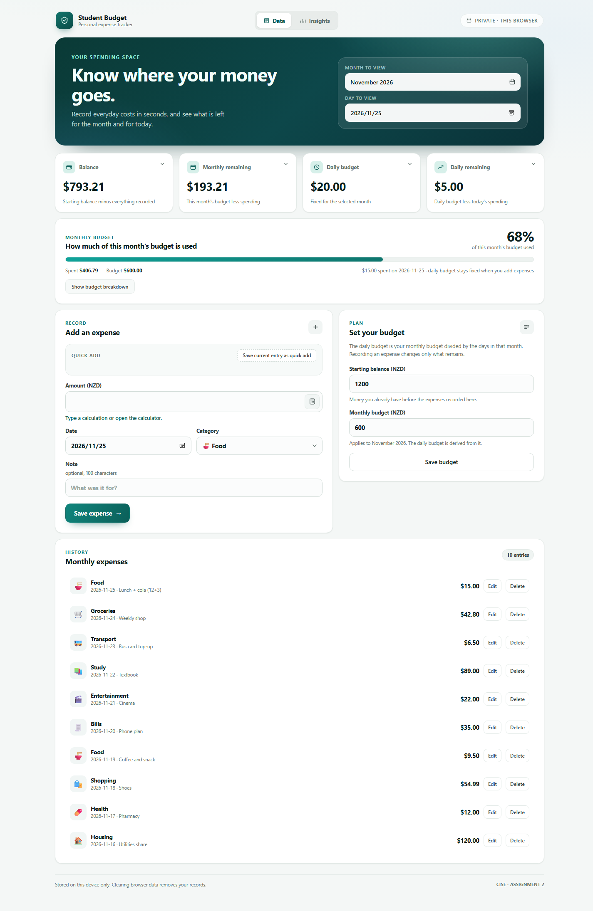
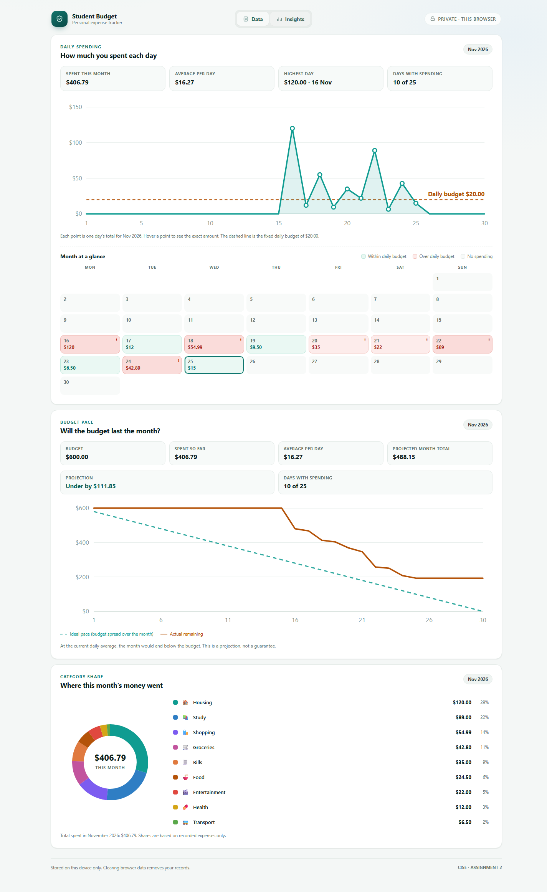

# Student Budget

A small browser-based expense tracker built for the CISE group assessment. The topic was confirmed with the lecturer in class. This repository contains the working prototype from Assignment 1, the Assignment 2 increment, and the evidence used in the evaluation report.



The application has two pages:

- **Data** - choose the month from a calendar picker, review the four summary cards and the monthly budget bar, record or edit an expense, set the budget, and browse the month's expenses.
- **Insights** - the daily spending trend, a calendar of the month showing each day against the fixed daily budget, the budget pace projection, and a category-share donut chart.



## What the application does

- Records an expense with an amount, date, category, and optional note.
- Saves repeat purchases as **quick adds** (for example a usual lunch) and records them in one click for the selected date.
- Accepts a calculation in the amount field, such as `12+3`, or a calculator keypad; the result is previewed before saving.
- Shows the selected month's expenses and deletes or edits a stored record (editing keeps the same record identifier). The list shows the most recent ten entries with a control to expand the rest.
- Summarises spending with ten icon-labelled categories and a category-share donut chart.
- Plots a daily spending trend for the selected month, with the total spent, the average per day, the highest day, and a dashed line for the fixed daily budget.
- Shows a calendar of the month where every day is coloured against the fixed daily budget (green within, red over, with a marker as well as colour); selecting a day lists that day's expenses.
- Compares the ideal spending pace with the actual remaining budget, and projects whether the month will finish under or over budget.
- Provides expandable detail panels on the summary cards:
  - **Balance** - the balance at the end of each day, with the lowest point.
  - **Monthly remaining** - budget pace and a projection for the end of the month.
  - **Daily budget** - the `budget / days` calculation and why spending never changes it.
  - **Daily remaining** - every expense recorded on the selected day.
- Opens a budget breakdown from the monthly budget bar, charting ideal pace against what actually happened.
- Keeps a starting balance and a month-specific budget, with a budget usage indicator.
- Derives a fixed daily budget from the monthly budget and the calendar days in the month. Recording an expense changes the remaining amounts, not the daily budget.

The interface is in English. Data is stored in this browser's `localStorage` only.

## Run

Install Node.js 18 or later, then from the repository root:

```
npm start
```

Open <http://127.0.0.1:8000>. No package download is required.

## Test

```
npm test
```

This uses Node's built-in test runner; 19 tests cover validation, deletion, editing, calculator parsing, category totals, daily spending totals, balance trend, budget settings, calendar-day calculation, and the fixed-daily-budget rule.

## Project and evidence

| Area | Link |
| --- | --- |
| Prioritised backlog and iteration plan | [docs/backlog.md](docs/backlog.md) |
| System overview and design decisions | [docs/design.md](docs/design.md) |
| Assignment 1 evidence index | [docs/evidence-index.md](docs/evidence-index.md) |
| Assignment 1 reviewed change | [PR #2](https://github.com/Guo7753/student-budget-app/pull/2) (merged, reviewed by Li Hao) |
| Assignment 2 Iteration 1 record | [docs/assignment-2-iteration-1.md](docs/assignment-2-iteration-1.md) |
| Assignment 2 Iteration 2 record | [docs/assignment-2-iteration-2.md](docs/assignment-2-iteration-2.md) |
| Assignment 2 evidence index | [docs/assignment-2-evidence-index.md](docs/assignment-2-evidence-index.md) |
| Assignment 2 increment | [PR #11](https://github.com/Guo7753/student-budget-app/pull/11) (merged, reviewed by Li Hao) |
| Assignment 2 daily progress log | [docs/daily-progress.md](docs/daily-progress.md) |
| Review checklist | [docs/pr-review-checklist.md](docs/pr-review-checklist.md) |
| Team demonstration guide | [docs/assignment-2-team-demo.md](docs/assignment-2-team-demo.md) |
| Interface redesign for the demonstration | [PR #13](https://github.com/Guo7753/student-budget-app/pull/13) |
| Contribution statements | [docs/individual-contribution-statements.md](docs/individual-contribution-statements.md) |

## Scope and limitations

The prototype is a personal coursework application. Receipt extraction remains an optional, deferred idea and must always ask the user to confirm extracted fields before saving. Income entry, bank integration, payment, shared accounts, and production handling of personal financial data are excluded. Browser-local storage is convenient for a short project but can be cleared and is not an appropriate production data store. Without income entry, the starting balance must be adjusted manually when money is added.

## Reuse and AI disclosure

The prototype and the planning material were prepared with AI assistance under Guo HouYang's direction, and this assistance is disclosed in the submitted reports as required by the course. The team remains responsible for the code, tests, references, and evidence. Research papers and the official Scrum Guide used in the planning discussion are listed in the reports. No third-party OCR service or reused application code is included.
