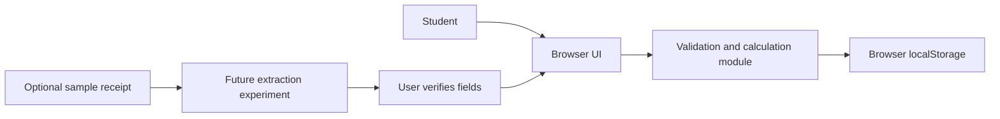

# System overview and design decisions

The app uses a browser UI and a separate pure JavaScript module for validation, record changes, and calculations. This keeps the core behavior testable without a browser or server. Browser localStorage removes setup and hosting work for the coursework prototype, but it is device-specific and can be cleared. The expense model stores an ID, amount, date, category, and optional note. A separate settings record stores the starting balance and a budget keyed by month. The UI builds list elements with `textContent`, so notes are displayed as text rather than inserted as HTML.

Daily budget is calculated only from the selected month's saved budget and the number of calendar days, rounded to cents. Daily remaining subtracts expenses on the selected date. Balance subtracts all saved expenses from the starting balance; income is outside the prototype. These definitions keep the daily allowance stable when a new expense is recorded.

The amount field accepts a restricted arithmetic expression. A small parser handles addition, subtraction, multiplication, division, and parentheses with normal precedence; it does not evaluate JavaScript code. It rejects invalid, non-positive, non-finite, and over-limit results, then stores the rounded numeric amount. The monthly chart aggregates expenses using the exact category list used by the form, including categories with zero spending. Adding or deleting an expense recalculates the chart and remaining balances, but not the fixed daily budget.

The optional receipt path is a future experiment, not a dependency of manual entry. Extracted values must be presented for confirmation. No real receipt image should be committed to GitHub. If the team later adopts an OCR library or service, it must document its license, data handling, and limitations.

