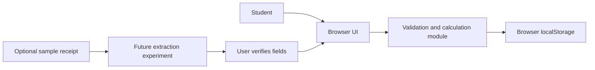

# System overview and design decisions

The app uses a browser UI and a separate pure JavaScript module for validation, record changes, and calculations. This keeps the core behavior testable without a browser or server. Browser localStorage removes setup and hosting work for the coursework prototype, but it is device-specific and can be cleared. The data model stores an ID, amount, date, category, and optional note for each expense. The UI builds list elements with `textContent`, so notes are displayed as text rather than inserted as HTML.

The optional receipt path is a future experiment, not a dependency of manual entry. Extracted values must be presented for confirmation. No real receipt image should be committed to GitHub. If the team later adopts an OCR library or service, it must document its license, data handling, and limitations.

