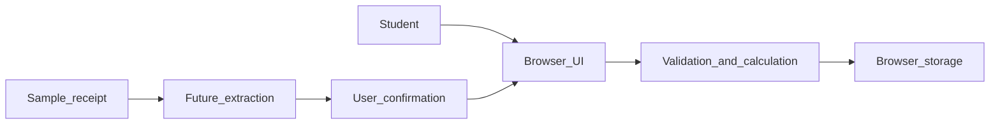

# Student Budget: Investigation and Project Plan

**CISE Assignment 1 | Group report draft | 10 November 2026**

**Members:** Guo HouYang (team lead), Chen GuangYuan, Li Hao, Shang JiaLe  
**Student IDs:** to be supplied by the group  
**Project approval:** pending lecturer confirmation  
**Repository:** https://github.com/Guo7753/student-budget-app  
**Submission commit:** pending reviewed merge  

## 1. Project definition

University students often make many small purchases but lack a quick way to see where their money goes. Student Budget is a small browser application for recording expenses and viewing monthly spending. The main stakeholder is a student who wants a low-effort overview; the lecturer assesses the engineering process, and the four-member team must maintain and test the product. The project aims to make entry simple and calculations trustworthy, rather than to provide financial advice.

The planned scope is manual expense entry, a monthly list, deletion or correction, and category totals. Receipt-image assistance is a stretch experiment: it may suggest fields, but the user must confirm before saving. Bank connections, payments, shared accounts, and production storage of sensitive financial data are excluded. The constraints are two short development iterations, a four-person team, a 1,500-word report, and the need to continue the same project in Assignment 2. Key engineering issues are changing user expectations about useful categories, integration and coordination across four contributors, and quality risks in calculations and image extraction. The topic must be approved before the plan is treated as final.

## 2. Development approach

A plan-driven approach would define features and design in detail before implementation. It gives clear documentation and traceability, but a student-facing interface may need changes after a quick usability check. An iterative and incremental approach delivers a small usable slice, tests it, and adjusts the next slice based on feedback. Its cost is more frequent coordination and a need to control scope. Dybå and Dingsøyr's (2008) systematic review cautions that empirical evidence varies by practice and context. Serrador and Pinto (2015) analysed 1,002 projects and found a positive association between agile use and project efficiency and stakeholder satisfaction; that result supports experimentation here but does not guarantee success for this team.

| Criterion | Plan-driven | Iterative and incremental |
| --- | --- | --- |
| Changing student needs | Revisions affect a detailed upfront plan | Feedback can reorder the next increment |
| Two short iterations | Documentation may consume early time | A usable slice can be tested early |
| Team coordination | Clear initial assignments | Frequent integration and review are needed |

We propose two short iterations with an ordered backlog, explicit acceptance criteria, a review at each iteration end, and a brief retrospective. This suits a small team and uncertain interface details. The first increment covers reliable manual records; the second adds spending insight and correction. A receipt experiment is attempted only after the core work meets its tests. We will use selected Scrum practices, such as a visible backlog and inspectable increments, without claiming a full Scrum implementation (Schwaber & Sutherland, 2020). For a regulated financial system, we would add stronger upfront security and compliance analysis, formal traceability, and more extensive verification before release. For a distributed team, we would rely more heavily on written decisions, small asynchronous reviews, and explicit handoff times.

## 3. Plan and design

The backlog sets proposed owners and testable outcomes; role assignments are not completed contributions.

| Item and proposed owner | Testable acceptance | Iteration |
| --- | --- | --- |
| B1 Guo | Valid entry persists after reload; zero or negative amount is rejected | 1 |
| B2 Guo, Li testing | Month filter shows matching records; deletion updates total | 1 |
| B3 Li, Guo integrating | Known fixture gives exact category and overall totals | 2 |
| B4 Chen, Li testing | Valid edit updates list and total; invalid edit is rejected | 2 |
| B5 Shang, stretch | Receipt suggestions require user correction and confirmation | 2 |

Iteration 1 delivers tested entry, month filtering, and deletion. Iteration 2 delivers tested category totals and editing. Shang will run [Q1](https://github.com/Guo7753/student-budget-app/issues/7), checking whether a synthetic HTML note displays literally and recording the browser, input, steps, and result. B5 starts only after required work passes.

The browser UI calls a separate validation and calculation module and stores records in localStorage (Figure 1). This allows logic tests without browser setup, though storage can be cleared. Risks and responses are scope growth (defer B5), extraction errors (confirm fields), integration conflicts (small reviewed PRs), and receipt privacy (synthetic or consented images only).

To evaluate process improvement, both iterations will record the share of completed items linked to Issue, PR, test, and CI evidence; hours to first teammate review; and review rounds. The first retrospective will choose a change from those results. The second will repeat the measures and account for task size and reviewer availability.

## 4. Collaborative workflow and trial

The workflow is Issue, short branch, implementation and test, teammate PR review, CI, then merge. [Issue 1](https://github.com/Guo7753/student-budget-app/issues/1) tracks entry; [PR 2](https://github.com/Guo7753/student-budget-app/pull/2) adds the prototype and five tests. The latest [Actions run](https://github.com/Guo7753/student-budget-app/actions/runs/42192009510) passed, and `npm start` served the app. Local work exposed that date parsing can normalize nonexistent dates, so a regression test now rejects them. The PR **still needs teammate review** before the trial and handoff reflection are complete.

## 5. Individual contributions

Guo HouYang directed the prototype and plan with Codex assistance, checked tests, opened [Issue 1](https://github.com/Guo7753/student-budget-app/issues/1), and submitted [PR 2](https://github.com/Guo7753/student-budget-app/pull/2). This AI use requires disclosure under course policy. Chen GuangYuan is assigned UI and editing, Li Hao tests and category totals, and Shang JiaLe quality and process evaluation. These are planned roles; final statements must describe actual work with links.

## Evidence index

The [repository](https://github.com/Guo7753/student-budget-app), [backlog](https://github.com/Guo7753/student-budget-app/blob/main/docs/backlog.md), [Issue 1](https://github.com/Guo7753/student-budget-app/issues/1), [PR 2](https://github.com/Guo7753/student-budget-app/pull/2), and [passing check](https://github.com/Guo7753/student-budget-app/actions/runs/42192009510) are linked. The review, submission commit, and assessor access remain pending.

## References

Dybå, T., & Dingsøyr, T. (2008). Empirical studies of agile software development: A systematic review. *Information and Software Technology, 50*(9-10), 833-859. https://doi.org/10.1016/j.infsof.2008.01.006

Schwaber, K., & Sutherland, J. (2020). *The Scrum Guide*. https://scrumguides.org/scrum-guide.html

Serrador, P., & Pinto, J. K. (2015). Does agile work? A quantitative analysis of agile project success. *International Journal of Project Management, 33*(5), 1040-1051. https://doi.org/10.1016/j.ijproman.2015.01.006

