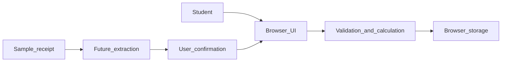

# Student Budget: Investigation and Project Plan

**CISE Assignment 1 | Group report draft | 6 November 2026**

**Members:** Guo HouYang (team lead), Chen GuangYuan, Li Hao, Shang JiaLe  
**Student IDs:** to be supplied by the group  
**Project approval:** pending lecturer confirmation  
**Repository:** https://github.com/Guo7753/student-budget-app  
**Submission commit:** pending reviewed merge  

## 1. Project definition

University students often make many small purchases but lack a quick way to see where their money goes. Student Budget is a small browser application for recording expenses and viewing monthly spending. The main stakeholder is a student who wants a low-effort overview; the lecturer assesses the engineering process, and the four-member team must maintain and test the product. The project aims to make entry simple and calculations trustworthy, rather than to provide financial advice.

The planned scope is manual expense entry, a monthly list, deletion or correction, and category totals. Receipt-image assistance is a stretch experiment: it may suggest fields, but the user must confirm before saving. Bank connections, payments, shared accounts, and production storage of sensitive financial data are excluded. The constraints are two short development iterations, a four-person team, a 1,500-word report, and the need to continue the same project in Assignment 2. Key engineering issues are changing user expectations about useful categories, integration and coordination across four contributors, and quality risks in calculations and image extraction. The topic must be approved before the plan is treated as final.

## 2. Development approach

A plan-driven approach would define features and design in detail before implementation. It gives clear documentation and traceability, but a student-facing interface may need changes after a quick usability check. An iterative and incremental approach delivers a small usable slice, tests it, and adjusts the next slice based on feedback. Its cost is more frequent coordination and a need to control scope. Empirical literature finds benefits of agile practices but also notes that evidence and context matter (Dybå & Dingsøyr, 2008; Serrador & Pinto, 2015).

| Criterion | Plan-driven | Iterative and incremental |
| --- | --- | --- |
| Changing student needs | Revisions affect a detailed upfront plan | Feedback can reorder the next increment |
| Two short iterations | Documentation may consume early time | A usable slice can be tested early |
| Team coordination | Clear initial assignments | Frequent integration and review are needed |

We propose two short iterations with an ordered backlog, explicit acceptance criteria, a review at each iteration end, and a brief retrospective. This suits a small team and uncertain interface details. The first increment covers reliable manual records; the second adds spending insight and correction. A receipt experiment is attempted only after the core work meets its tests. We will use selected Scrum practices, such as a visible backlog and inspectable increments, without claiming a full Scrum implementation (Schwaber & Sutherland, 2020). For a regulated financial system, we would add stronger upfront security and compliance analysis, formal traceability, and more extensive verification before release. For a distributed team, we would rely more heavily on written decisions, small asynchronous reviews, and explicit handoff times.

## 3. Plan and design

The highest-priority backlog items are B1, save a valid expense and reject zero or negative amounts; B2, show and delete monthly records; B3, calculate category and overall totals against known fixtures; and B4, edit an incorrect record. B5, receipt-assisted entry, is optional and requires manual confirmation. The full acceptance criteria and owners are in the linked backlog. Iteration 1 succeeds when a student can enter, find, and delete a record and the tests pass. Iteration 2 succeeds when category totals are exact for a known dataset and a user can correct a record. The team will defer B5 if B1-B4 are incomplete.

The system has a browser interface, a separate validation and calculation module, and browser localStorage. Separation allows logic tests without browser setup; localStorage keeps the prototype simple but loses data if browser storage is cleared. The optional image path would suggest values for user confirmation and would use only synthetic or consented examples. The main risks are excess scope, inaccurate extraction, integration conflicts, and privacy. We address them through backlog priority, manual verification, small reviewed changes, and avoiding real receipt images in the repository.

## 4. Collaborative workflow and trial

The intended workflow is Issue with acceptance criteria, short branch, implementation and test, Pull Request, review by another member, automated check, then merge. The tracked requirement is [Issue 1](https://github.com/Guo7753/student-budget-app/issues/1). [Pull Request 2](https://github.com/Guo7753/student-budget-app/pull/2) adds manual entry, validation, monthly listing and total, deletion, and five automated tests. The [GitHub Actions run](https://github.com/Guo7753/student-budget-app/actions/runs/42189317660) passed. The PR is still open and **has not received a teammate review**, so the workflow trial and its reflection are incomplete. We will describe the actual lesson learned after review, rather than inventing one.

## 5. Individual contributions

Guo HouYang directed and produced the current proof of concept and planning draft, opened [Issue 1](https://github.com/Guo7753/student-budget-app/issues/1), and submitted [PR 2](https://github.com/Guo7753/student-budget-app/pull/2). Chen GuangYuan is assigned UI and usability review, Li Hao acceptance testing and category totals, and Shang JiaLe documentation, risk review, and the optional image experiment. These are future responsibilities, not completed contributions. The final version must replace this paragraph with verified activities and links for each member. If the work remains solely Guo's, the contribution record must say so.

## Evidence index

The [repository](https://github.com/Guo7753/student-budget-app), [backlog](https://github.com/Guo7753/student-budget-app/blob/main/docs/backlog.md), [Issue 1](https://github.com/Guo7753/student-budget-app/issues/1), [PR 2](https://github.com/Guo7753/student-budget-app/pull/2), and [passing check](https://github.com/Guo7753/student-budget-app/actions/runs/42189317660) are available. The submission commit and teammate review remain pending. Ensure the assessor can access this private repository.

## References

Dybå, T., & Dingsøyr, T. (2008). Empirical studies of agile software development: A systematic review. *Information and Software Technology, 50*(9-10), 833-859. https://doi.org/10.1016/j.infsof.2008.01.006

Schwaber, K., & Sutherland, J. (2020). *The Scrum Guide*. https://scrumguides.org/scrum-guide.html

Serrador, P., & Pinto, J. K. (2015). Does agile work? A quantitative analysis of agile project success. *International Journal of Project Management, 33*(5), 1040-1051. https://doi.org/10.1016/j.ijproman.2015.01.006

